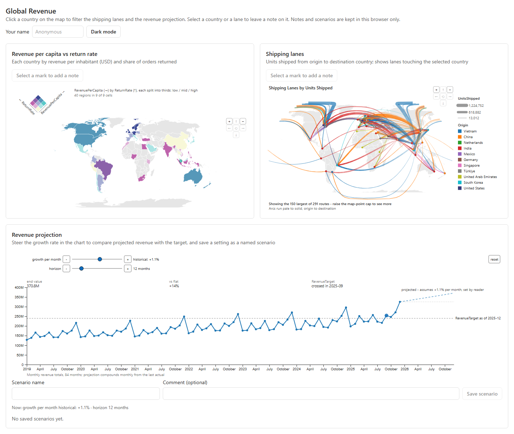

# Global Revenue (web)

**Live: https://codexguy.github.io/bicharts-fabric-app-demo/**

The Global Revenue dashboard as a plain static web page: no Fabric, no Rayfin, no sign-in. It is the browser-only version of the Fabric App built in [Building Fabric Apps with an AI agent: 5 prompts, 2 MCP servers](https://bizintelligencechampions.com/articles/fabric-app-two-mcp-servers): the same three RegiaBI charts and the same cross-filtering, reading the model's data as CSV files.



- **Data:** the model's CSV files, fetched in the browser from
  `https://raw.githubusercontent.com/codexguy/bicharts/main/examples/fabric-app/data`
  (override with `VITE_DATA_BASE_URL`). Revenue per capita, return rate, units shipped, revenue and target are
  computed in `src/data/model.ts`.
- **Notes and saved scenarios:** kept in this browser's `localStorage` (`global-revenue.notes`,
  `global-revenue.scenarios`). They are not shared with other people or other browsers.
- **Charts:** RegiaBI charts in `src/charts/`, hosted with `@bicharts/chart-host`.

```
npm install
npm run dev       # local development
npm run build     # static site in dist/, served from any path
npm test
```

To check the calculations against the semantic model's own results:
`DATA_DIR=<folder of the CSVs> EXPECTED_DIR=<folder of model results as CSV> npm test`.

## Publishing to GitHub Pages

`.github/workflows/deploy-pages.yml` builds the site and publishes `dist/` on every push to `main` (or by hand from
the Actions tab). One-time setup in the repository: **Settings -> Pages -> Build and deployment -> Source: GitHub
Actions**. The site is built with relative paths (`base: "./"`), so it works at `https://<user>.github.io/<repo>/`
without any further configuration.
